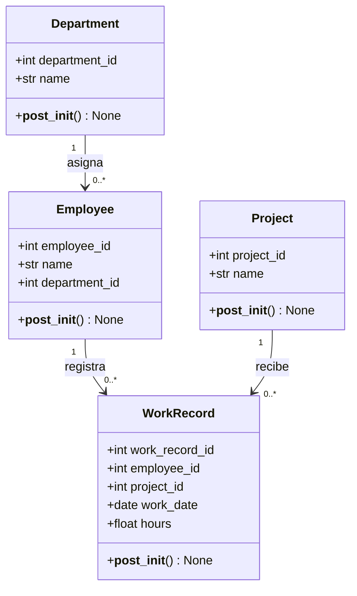

# UML_base_v1 — Referencia histórica de EcoTech

> Archivo conservado del prototipo EcoTech/SQLite; no es el UML de Viajes Aventura. El modelo turístico está en `docs/uml.md`.

> Esta versión conserva la primera propuesta derivada del texto compartido para el taller. **No es el UML original de la evaluación anterior ni consta como validada por el equipo o el docente.** Los atributos, tipos y relaciones son supuestos explícitos para el prototipo.

## Diagrama de clases de referencia

`WorkRecord` relaciona un `Employee` con un `Project`. Los identificadores pueden ser `None` antes de la inserción en SQLite.

## Responsabilidades y datos propuestos

| Clase | Datos iniciales propuestos | Responsabilidad de referencia |
|---|---|---|
| `Department` | `department_id: int \| None`, `name: str` | Representar un departamento. |
| `Employee` | `employee_id: int \| None`, `name: str`, `department_id: int` | Representar la entidad de apoyo asociada a un departamento. |
| `Project` | `project_id: int \| None`, `name: str` | Representar un proyecto. |
| `WorkRecord` | `work_record_id: int \| None`, `employee_id: int`, `project_id: int`, `work_date: date`, `hours: float` | Registrar horas de trabajo de una persona en un proyecto. |

## Relaciones propuestas

- `Department 1 --> 0..* Employee`.
- `Employee 1 --> 0..* WorkRecord`.
- `Project 1 --> 0..* WorkRecord`.

## Revisión necesaria

El equipo debe comparar esta referencia con el UML de la evaluación anterior y confirmar entidades, responsabilidades, atributos, métodos, tipos, restricciones y multiplicidades. Esta es la referencia histórica de EcoTech. `docs/uml.md` ahora describe Viajes Aventura y no debe utilizarse para validar este modelo.
