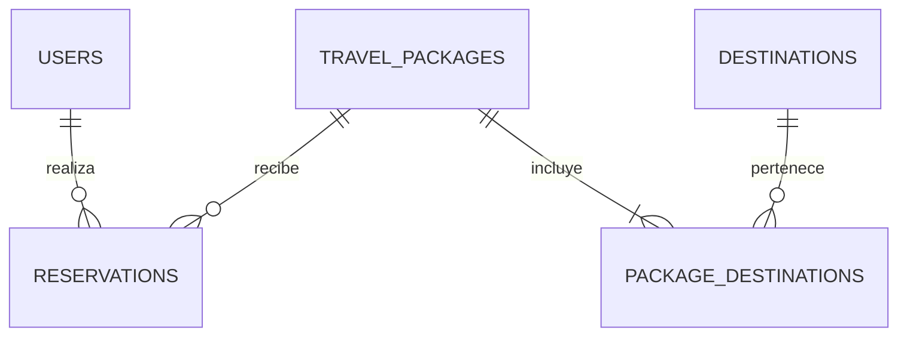

# Modelo relacional — Viajes Aventura

## Motor y creación

La aplicación de Viajes Aventura utiliza MariaDB/InnoDB en la base existente `viajes_aventura`, host `127.0.0.1`, puerto `3307`, codificación `utf8mb4` y collation `utf8mb4_unicode_ci`. `src/viajes/persistence/schema.py` crea cinco tablas con `CREATE TABLE IF NOT EXISTS`; no elimina, vacía ni recrea la base. El inicializador previo `src/persistence/create_viajes_db.py` mantiene su comportamiento de crear solo la base.

## Entidades y restricciones

| Tabla | Columnas principales | Integridad |
|---|---|---|
| `users` | `user_id BIGINT UNSIGNED` PK; `full_name VARCHAR(120)`; `email VARCHAR(254)`; `password_hash VARCHAR(255)`; `role VARCHAR(20)`; `created_at TIMESTAMP` | Correo único; nombre no vacío; rol `customer` o `admin`; nunca se almacena contraseña en claro. |
| `destinations` | `destination_id BIGINT UNSIGNED` PK; `name VARCHAR(120)`; `country VARCHAR(100)`; `description TEXT` | Nombre y país únicos en conjunto; nombre y país obligatorios. |
| `travel_packages` | `package_id BIGINT UNSIGNED` PK; `name VARCHAR(160)`; `description TEXT`; `start_date DATE`; `end_date DATE`; `unit_price DECIMAL(12,2)`; `available_slots INT UNSIGNED` | Inicio y término obligatorios; término no anterior al inicio; precio positivo; disponibilidad no negativa. |
| `package_destinations` | `package_id`, `destination_id` | PK compuesta; FK al paquete con `ON DELETE CASCADE`; FK al destino con `ON DELETE RESTRICT`; evita pares repetidos. |
| `reservations` | `reservation_id BIGINT UNSIGNED` PK; `user_id`, `package_id`; `booked_at TIMESTAMP`; `travelers INT UNSIGNED`; `unit_price DECIMAL(12,2)`; `total_price DECIMAL(14,2)`; `status VARCHAR(20)` | FK de usuario y paquete con `ON DELETE RESTRICT`; viajeros y precios positivos; estado `confirmed` o `cancelled`; índices para consultas por usuario y paquete/estado. |

`package_destinations` representa la relación N:M: un paquete debe incluir uno o más destinos y un destino puede pertenecer a varios paquetes. Cada reserva se asocia a exactamente un usuario y un paquete. Las eliminaciones con relaciones activas se rechazan para preservar el historial.

## Relaciones

Los DAO de paquetes guardan el registro y sus destinos en una transacción. Las reservas bloquean la fila del paquete (`FOR UPDATE`), verifican su fecha y disponibilidad, descuentan los viajeros e insertan el precio unitario y total en una transacción; la cancelación repone la disponibilidad.

## Supuestos y estado

- `available_slots` representa los cupos que quedan disponibles; se reduce al confirmar una reserva y se repone al cancelarla.
- El precio de reserva es una instantánea del precio por persona vigente al reservar; `TravelPackage.calculate_total()` es la única regla de cálculo de importes.
- Los días de duración se calculan inclusivamente entre las dos fechas.
- El esquema es idempotente para tablas ausentes. `CREATE TABLE IF NOT EXISTS` no migra tablas antiguas si tuvieran una estructura distinta; revisar cualquier discrepancia antes de operar sobre tablas ya existentes.
- La inicialización real se ejecutó correctamente. Se verificaron las cinco tablas InnoDB con collation `utf8mb4_unicode_ci`, las cuatro FKs y sus reglas, índices y once checks. La prueba integrada CRUD/auth/reservas pasó y limpió los registros aislados creados por ella.

La integración MariaDB y la suite completa se ejecutaron: 45 pruebas aprobadas, incluidas cuatro integraciones. Una de ellas sincroniza dos conexiones independientes contra el último cupo y confirma que solo una reserva se confirma, la disponibilidad no queda negativa y el total reservado más los cupos disponibles sigue siendo consistente. El esquema EcoTech anterior pertenece al prototipo SQLite y permanece separado; no se modificaron sus tablas ni sus archivos de datos.
