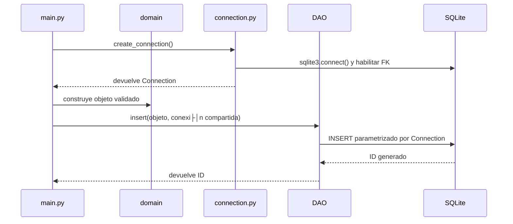

# Recorrido del proyecto EcoTech Solutions

Esta guía explica el prototipo en orden de ejecución. El UML usado es una referencia pendiente de validación; los ejemplos usan datos ficticios.

## 1. Ubicar cada parte

- `src/domain/` contiene los objetos del dominio y validaciones sencillas.
- `src/persistence/` contiene la conexi├│n SQLite, el esquema y los DAO.
- `src/main.py` coordina la demostraci├│n.
- `tests/` contiene las pruebas automatizadas.
- `data/ecotech.db` aparece al ejecutar el programa; es una base local y está ignorada por Git.
- `docs/` contiene el UML de referencia, su revisi├│n, el modelo de datos, responsabilidades, planificaci├│n y decisiones.

## 2. Crear objetos del dominio

El programa construye objetos Python antes de guardarlos:

```python
department = Department(name="Departamento de prueba")
project = Project(name="Proyecto de prueba")
```

El dominio no conoce SQL. Por ejemplo, `Department` comprueba que el nombre no est├® vac├¡o; `WorkRecord` comprueba que sus IDs sean positivos, que la fecha sea v├ílida y que las horas sean mayores que cero. Los IDs de los objetos nuevos se generan al insertarlos.

## 3. Abrir la base y preparar las tablas

`main.py` llama a `create_connection()` de `connection.py`. Esa funci├│n abre `data/ecotech.db` (creando la carpeta si es necesario) y activa `PRAGMA foreign_keys = ON`. Despu├®s, `create_tables()` de `create_db.py` crea las tablas si todav├¡a no existen:

- `departments`
- `employees`
- `projects`
- `work_records`

Las claves foráneas expresan las relaciones entre departamentos y empleados, y entre registros, empleados y proyectos.

## 4. Insertar datos usando los DAO

`main.py` comparte la misma conexi├│n con los DAO y ejecuta esta secuencia:

1. `DepartmentDAO.insert()` guarda el departamento y devuelve su ID.
2. `EmployeeDAO.insert()` guarda un empleado de apoyo usando ese ID.
3. `ProjectDAO.insert()` guarda el proyecto y devuelve su ID.
4. `WorkRecordDAO.insert()` usa los IDs del empleado y el proyecto para guardar fecha y horas.

Los DAO ejecutan consultas parametrizadas: el SQL tiene marcadores `?` y los valores se envían por separado. SQLite devuelve el ID generado; el programa muestra los resultados en español y cierra la conexión.

## 5. Flujo entre m├│dulos

El siguiente diagrama distingue la construcci├│n de objetos y la conexi├│n compartida. En el c├│digo, `main.py` crea la conexi├│n y la inyecta a los DAO; los DAO no llaman directamente a `connection.py`.



## 6. Ejemplo sencillo de relaciones

Si el departamento reci├®n insertado recibe el ID `1`, el empleado de apoyo guarda `department_id=1`. Si el proyecto recibe el ID `1`, `WorkRecord` puede guardar `employee_id=1` y `project_id=1`. SQLite rechaza el registro si alguno de esos IDs no existe.

Las relaciones son las del modelo de referencia: un departamento puede tener muchos empleados; un empleado puede tener muchos registros; un proyecto puede tener muchos registros. El equipo debe validarlas contra el UML original.

## 7. Ejecutar el programa y las pruebas

Desde la raíz del repositorio:

```powershell
python src/main.py
python -m unittest discover -s tests -v
```

La aplicaci├│n usa `data/ecotech.db`, por lo que las ejecuciones repetidas agregan otra serie de datos ficticios. Las pruebas usan una base `:memory:` y no dependen de esa base local.

## 8. Responsabilidades propuestas

| Integrante | Trabajo principal propuesto | Trabajo compartido |
|---|---|---|
| Pamela | Liderar `Department` y `Project`. | Integraci├│n y revisi├│n del repositorio. |
| Valentina | Liderar `WorkRecord`; revisar su relaci├│n con `Employee` y `Project`; organizar tareas Kanban. | UML, integraci├│n y pruebas generales. |
| Ambas | ÔÇö | Revisi├│n del UML, pruebas, integraci├│n y revisi├│n por Pull Request. |

Esta distribución está pendiente de acuerdo definitivo; tampoco confirma que Valentina tenga permisos de repositorio.

## 9. Documentos y solapamientos

No se elimin├│ ni combin├│ ning├║n documento. Se observaron estos solapamientos intencionales:

- `docs/UML_base_v1.md` y `docs/uml.md` contienen diagramas y entidades similares. El primero conserva la primera referencia; el segundo es el documento de trabajo que el equipo debe actualizar. Ambos advierten que no son el UML original validado.
- `docs/class8_implementation_plan.md` se parece a `docs/development_plan.md` en tareas y ramas. El primero sigue la actividad de Clase 8; el segundo conserva la planificaci├│n general del proyecto.
- La tabla breve del README repite parte de `docs/team_responsibilities.md`. El README ofrece una vista rápida; el documento detalla evidencia y ramas.
- `docs/jira_tasks.md` y `docs/development_plan.md` organizan tareas. El primero prepara tarjetas de Clase 8 para Jira; el segundo mantiene el plan global propuesto.
- `docs/uml_review.md`, `docs/database_model.md` y `docs/decisions.md` comparten algunos supuestos, pero respectivamente registran observaciones UML, estructura de tablas y decisiones pendientes.

Estas funciones pueden cambiar si el equipo decide consolidar documentaci├│n. No se combinaron porque cumplen niveles distintos y la solicitud pide conservarlos.

## 10. Consistencia de nombres

Los m├│dulos Python usan `snake_case` (`work_record.py`, `work_record_dao.py`) y las clases usan `PascalCase` (`WorkRecord`, `WorkRecordDAO`). Las tablas y columnas SQL usan `snake_case`. `UML_base_v1.md` conserva la capitalizaci├│n solicitada para identificar la referencia base; no es un m├│dulo Python ni un duplicado accidental.

## 11. Documentos centrales y complementarios

Según los entregables explícitos del material compartido, los elementos centrales son:

- Repositorio y c├│digo ejecutable, con estructura, clases, DAO e inserciones.
- `docs/uml.md`: UML actualizado (actualmente, propuesta pendiente de validaci├│n).
- `docs/team_responsibilities.md`: asignaci├│n de responsabilidades.
- `README.md`: descripci├│n y estado del proyecto.

Como evidencias de las actividades detalladas tambi├®n se usan `docs/database_model.md` (tablas y claves), `docs/UML_base_v1.md` y `docs/uml_review.md` (referencia y revisi├│n), las pruebas y `docs/class8_implementation_plan.md` (avance y bloqueos). `docs/development_plan.md` registra el flujo de ramas; `docs/jira_tasks.md` prepara tarjetas, sin afirmar que Jira haya sido actualizado.

Como material complementario para comprender y mantener el proyecto quedan `docs/architecture.md`, `docs/requirements.md`, `docs/decisions.md` y esta guía. Esta clasificación se basa en el texto compartido; conviene contrastarla con las instrucciones formales del docente.
