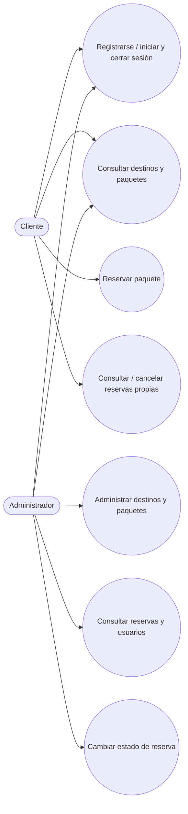
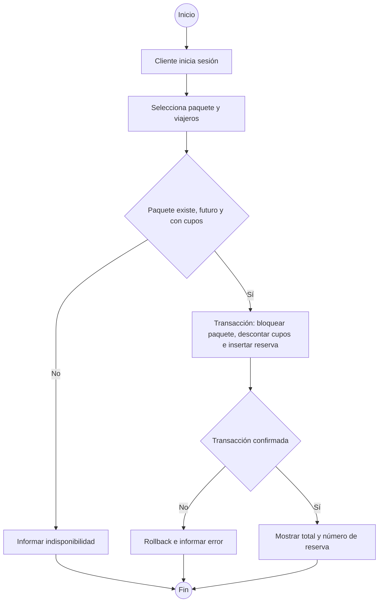

# Requerimientos — Viajes Aventura

## Alcance y priorización

| Prioridad | Alcance |
|---|---|
| Alta | Usuarios/roles, autenticación, destinos, paquetes y relación con destinos, reservas seguras y disponibilidad, persistencia MariaDB. |
| Media | Consultas por usuario, historial y cambios de estado; pruebas automatizadas y documentación evaluable. |
| Baja | Funciones adicionales no solicitadas (pagos, notificaciones, integración externa): fuera de alcance y pendientes de confirmar. |

## Requerimientos funcionales

| ID | Requerimiento | Prioridad | Estado local |
|---|---|---|---|
| RF-01 | Registrar clientes e iniciar/cerrar sesión con correo y contraseña. | Alta | Implementado y probado contra MariaDB. |
| RF-02 | Almacenar credenciales como hash PBKDF2-HMAC con sal aleatoria; nunca texto plano. | Alta | Implementado y probado unitariamente. |
| RF-03 | Crear, listar, buscar, modificar y eliminar destinos, evitando duplicados y eliminación referenciada. | Alta | CRUD real verificado. |
| RF-04 | Crear, listar, buscar, modificar y eliminar paquetes con fechas, precio, disponibilidad y uno o más destinos. | Alta | CRUD real verificado. |
| RF-05 | Reservar paquetes existentes para usuarios existentes, descontando disponibilidad de manera atómica. | Alta | Reserva real probada; prueba concurrente con dos conexiones dejó una sola confirmación para el último cupo y disponibilidad consistente. |
| RF-06 | Consultar reservas propias; administración puede consultar todas y cambiar estados. | Media | Login/roles e historial real verificados. |
| RF-07 | Cancelar/reabrir reservas solo si el estado y la disponibilidad lo permiten; reponer cupos al cancelar. | Alta | Cancelación, reapertura y disponibilidad real verificadas. |
| RF-08 | Ofrecer administración de destinos, paquetes y usuarios solo al rol `admin`. | Alta | Roles y permisos probados contra MariaDB; bootstrap inicial disponible. |
| RF-09 | Crear tablas turísticas sin borrar tablas ni registros existentes. | Alta | Cinco tablas inicializadas y metadatos verificados en MariaDB. |
| RF-10 | Mantener el programa y persistencia históricos de EcoTech aislados. | Alta | `src/main.py` y persistencia EcoTech no modificados. |

## Requerimientos no funcionales

| ID | Requerimiento | Prioridad | Criterio |
|---|---|---|---|
| RNF-01 | MariaDB, InnoDB, `utf8mb4`; conexión `127.0.0.1:3307` por la configuración existente. | Alta | Conexión real e inicialización/verificación de las cinco tablas probadas; proveedor de conexión sin cambios. |
| RNF-02 | Consultas parametrizadas y transacciones en operaciones multitabla. | Alta | `%s` en consultas y `commit`/`rollback` en DAO. |
| RNF-03 | Separación de dominio, persistencia, autenticación e interfaz. | Alta | Paquete `src/viajes/`; entry point separado. |
| RNF-04 | Errores de interfaz sin exponer detalles de DB ni credenciales. | Alta | Mensajes genéricos para errores del conector y autenticación. |
| RNF-05 | Entradas validadas; fechas con ISO-8601; precios `Decimal`; integridad por FKs/checks. | Alta | Dominio y esquema. |
| RNF-06 | Credenciales de conexión solo en variables de entorno/local `.env`; nunca imprimir secretos. | Alta | Configuración existente conservada; conexión y operaciones de integración verificadas. |
| RNF-07 | No introducir dependencias de hashing adicionales. | Media | Hash de contraseña de la biblioteca estándar. |
| RNF-08 | Pruebas unitarias no destruyen ni alteran bases reales. | Alta | DAO/esquema simulados; cuatro pruebas MariaDB optativas y ejecutadas con filas únicas y limpieza por PK exacta. |

## Historias de usuario

| ID | Historia | Aceptación | Prioridad |
|---|---|---|---|
| HU-01 | Como cliente quiero registrar una cuenta e iniciar sesión para gestionar mis viajes. | Correo único; contraseña no se almacena en claro; error de autenticación genérico. | Alta |
| HU-02 | Como administrador quiero administrar destinos y paquetes para ofrecer viajes actualizados. | CRUD, relaciones de destinos y restricciones de integridad. | Alta |
| HU-03 | Como cliente quiero reservar un paquete para las personas de mi grupo. | Solo paquete futuro; cupos suficientes; precio total y snapshot almacenados. | Alta |
| HU-04 | Como cliente quiero ver y cancelar mis reservas. | No puedo ver/modificar reservas ajenas; cancelación restaura cupos una sola vez. | Alta |
| HU-05 | Como administrador quiero consultar y cambiar el estado de reservas. | Reapertura valida fechas y disponibilidad; historial preservado. | Media |

La ejecución completa con `VIAJES_RUN_INTEGRATION_TESTS=1` aprobó 45 pruebas, incluidas cuatro integraciones MariaDB. Se probaron conexión, inicialización del esquema, CRUD, autenticación, roles, reservas, cancelaciones y la carrera por el último cupo. La demostración autenticada completa en una terminal interactiva real sigue pendiente; los flujos por rol se ejercitaron con entradas controladas.

## Diagrama de casos de uso

## Flujo BPMN simplificado: reserva

El diagrama es una vista de proceso para evaluación/documentación, no un archivo BPMN 2.0 ejecutable.

## Trazabilidad de requerimientos y diagramas

| Requerimientos | Caso de uso | Proceso | Modelo/tabla | Código/pruebas |
|---|---|---|---|---|
| RF-01, RF-02, RF-08; RNF-04, RNF-06 | Sesión / administración | Inicio de sesión en BPMN | `User`, `users` | `auth.py`, `user_dao.py`, pruebas auth |
| RF-03, RF-04 | Administrar destinos y paquetes | Administración (pendiente de diagrama detallado) | `Destination`, `TravelPackage`, `package_destinations` | DAO de destinos/paquetes |
| RF-05, RF-07 | Reservar / cancelar / cambiar estado | BPMN reserva | `Reservation`, `reservations` | `reservation_dao.py`, pruebas DAO |
| RF-09, RNF-01, RNF-02, RNF-05 | Todas las acciones persistentes | Reserva | Modelo relacional | `schema.py`, pruebas de esquema |
| RF-10 | Fuera de casos de uso Viajes | — | Esquema EcoTech separado | Pruebas preexistentes conservadas |

Las tareas de confirmación del caso y validación del equipo/docente, si son requeridas, siguen pendientes; no se atribuye aprobación inexistente.
