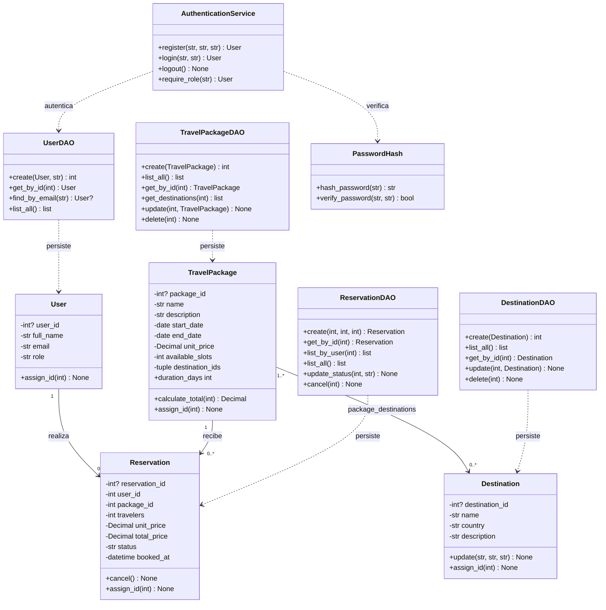

# UML de clases — Viajes Aventura

## Alcance

Este diagrama describe el modelo que implementa el código del proyecto Viajes Aventura. Es una propuesta técnica de esta entrega; aprobación por el equipo/docente queda pendiente de confirmar.

## Responsabilidades y reglas relevantes

- Las entidades validan sus valores y mantienen campos privados con propiedades de lectura.
- `TravelPackage.calculate_total()` es la operación central de precio total: precio unitario multiplicado por viajeros, con `Decimal`.
- La duración se calcula inclusivamente a partir de las fechas.
- El paquete requiere al menos un destino; el DAO persiste el vínculo N:M de forma transaccional.
- `User` no guarda ni expone la contraseña en claro; el hash se maneja por el servicio/DAO de autenticación.
- `Reservation` conserva el precio unitario de la compra y controla la transición local de cancelación.
- Los DAO dependen de la conexión MySQL existente y no pertenecen al dominio.

## Límites / confirmación pendiente

El modelo relacional se detalla en `database_model.md`. La asociación UML de paquetes y destinos se realiza mediante IDs y la tabla intermedia, no mediante listas de objetos en memoria. El equipo debe confirmar nombres/campos y que las reglas académicas coinciden con la rúbrica; no se afirma aprobación docente.
