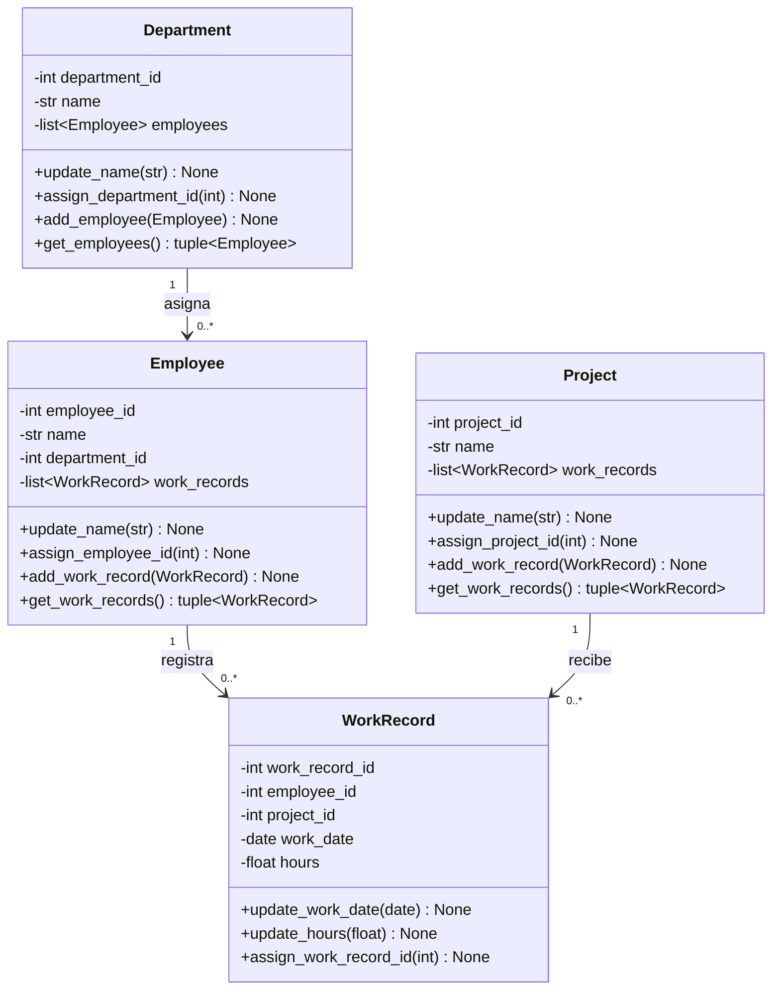

# UML de referencia ÔÇö EcoTech Solutions

> **Estado:** propuesta de trabajo basada en el enunciado compartido para el taller. El UML original de la evaluación anterior no está disponible en el repositorio y este documento **no afirma que el modelo haya sido validado por el equipo ni por el docente**. Los atributos y tipos sugeridos deben revisarse antes de considerarlos definitivos.

## Diagrama de clases propuesto

Los atributos se almacenan de forma privada y se consultan mediante propiedades de solo lectura. Los m├®todos `update_*` validan modificaciones, y los m├®todos `add_*`/`remove_*` controlan las asociaciones. Las consultas de colecciones devuelven tuplas, no las listas internas. Los identificadores generados por SQLite pueden ser `None` antes de insertar y se asignan una sola vez despu├®s de persistir. `WorkRecord` enlaza un empleado con un proyecto.

## Responsabilidades propuestas

| Clase | Responsabilidad de referencia | Estado |
|---|---|---|
| `Department` | Representar un departamento. | Pendiente de validar con el equipo y el UML original. |
| `Employee` | Entidad de apoyo asociada a un departamento y a registros de trabajo. | Pendiente de validar. |
| `Project` | Representar un proyecto. | Pendiente de validar. |
| `WorkRecord` | Registrar fecha y horas de un empleado en un proyecto. | Pendiente de validar. |

## Atributos y tipos propuestos

| Clase | Atributo | Tipo Python | Observaci├│n |
|---|---|---|---|
| `Department` | `department_id` | `int \| None` | Clave generada al persistir. |
| `Department` | `name` | `str` | Nombre de referencia. |
| `Employee` | `employee_id` | `int \| None` | Clave generada al persistir. |
| `Employee` | `name` | `str` | Nombre de referencia; atributos personales adicionales no definidos. |
| `Employee` | `department_id` | `int` | Referencia obligatoria a `Department`. |
| `Project` | `project_id` | `int \| None` | Clave generada al persistir. |
| `Project` | `name` | `str` | Nombre de referencia. |
| `WorkRecord` | `work_record_id` | `int \| None` | Clave generada al persistir. |
| `WorkRecord` | `employee_id` | `int` | Referencia obligatoria a `Employee`. |
| `WorkRecord` | `project_id` | `int` | Referencia obligatoria a `Project`. |
| `WorkRecord` | `work_date` | `date` | Fecha del registro. |
| `WorkRecord` | `hours` | `float` | Cantidad positiva de horas. |

Los atributos y tipos son supuestos mínimos para habilitar las inserciones solicitadas; deben compararse con el modelo del curso y las reglas de negocio reales.

## M├®todos p├║blicos de referencia

| Clase | M├®todos | Responsabilidad |
|---|---|---|
| `Department` | `update_name`, `assign_department_id`, `add_employee`, `get_employees` | Validar cambios al nombre e ID; controlar empleados asociados y devolver una tupla. |
| `Employee` | `update_name`, `assign_employee_id`, `add_work_record`, `get_work_records` | Validar cambios al nombre e ID; controlar registros asociados y devolver una tupla. |
| `Project` | `update_name`, `assign_project_id`, `add_work_record`, `get_work_records` | Validar cambios al nombre e ID; controlar registros recibidos y devolver una tupla. |
| `WorkRecord` | `update_work_date`, `update_hours`, `assign_work_record_id` | Validar cambios a fecha y horas; asignar una sola vez el ID generado. |

## Relaciones y multiplicidades de referencia

| Origen | Relaci├│n | Destino | Multiplicidad |
|---|---|---|---|
| `Department` | Asociaci├│n | `Employee` | Un departamento (`1`) puede tener cero o muchos empleados (`0..*`); cada empleado se asocia a un departamento. |
| `Employee` | Asociaci├│n | `WorkRecord` | Un empleado (`1`) puede tener cero o muchos registros (`0..*`); cada registro corresponde a un empleado. |
| `Project` | Asociaci├│n | `WorkRecord` | Un proyecto (`1`) puede tener cero o muchos registros (`0..*`); cada registro corresponde a un proyecto. |

## Supuestos y validaciones pendientes

- Confirmar que las cuatro entidades y las tres relaciones correspondan al UML original.
- Confirmar atributos, tipos, reglas de negocio, obligatoriedad y visibilidad.
- Confirmar que un empleado pertenezca a un ├║nico departamento.
- Confirmar si las horas deben ser num├®ricas positivas y c├│mo se expresan.
- No se afirma que este documento sea una copia del UML original ni que haya sido aprobado.
